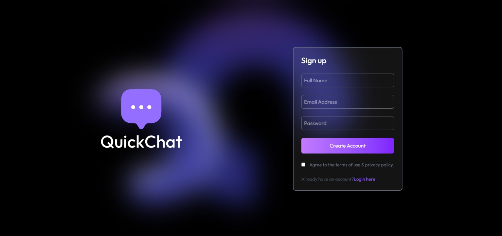
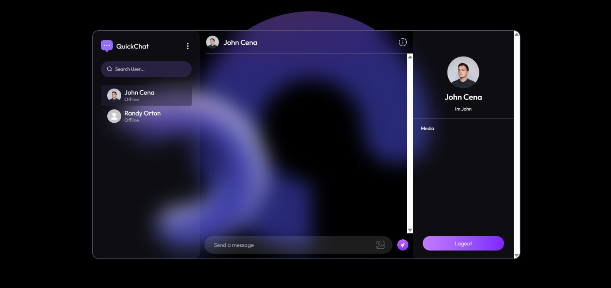
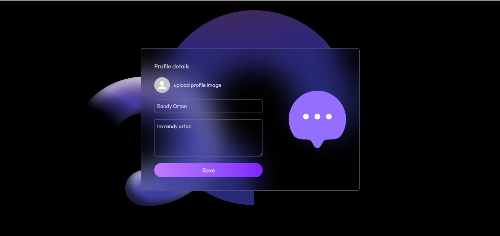

# 💬 Chat App

A full-stack, real-time chat application built with the **MERN stack** and **Socket.IO**. Users can sign up, chat one-to-one, share images, update their profile, and see who is online, with unread-message badges in the sidebar.

🔗 **Live demo:** [https://chat-app-nu-one-53.vercel.app]

---

## 📸 Screenshots

### Login


### Chat


### Profile

---

## ✨ Features

- 🔐 **Authentication:** signup, login and logout with JWT, and passwords hashed with bcrypt
- 💬 **Real-time messaging:** messages are delivered instantly using Socket.IO
- 🖼️ **Image sharing:** send images in chat, stored on Cloudinary
- 🟢 **Online status:** see which users are online right now
- 🔔 **Unread message badges:** the sidebar shows a count of unseen messages per user
- 👤 **Profile management:** update your name, bio and profile picture
- 🔒 **Protected routes:** the API is secured with token-based middleware
- 📱 **Responsive UI:** built with Tailwind CSS

---

## 🛠️ Tech Stack

| Layer | Technologies |
|---|---|
| Frontend | React.js (Vite), React Router, Context API, Axios, Tailwind CSS, React Hot Toast |
| Backend | Node.js, Express.js |
| Database | MongoDB Atlas with Mongoose |
| Real-time | Socket.IO |
| Authentication | JSON Web Tokens (JWT), bcrypt |
| Media storage | Cloudinary |
| Deployment | Vercel |

---

## 📁 Project Structure

```
chat-app/
├── client/                  # React frontend (Vite)
│   ├── context/             # AuthContext, ChatContext
│   └── src/
│       ├── components/      # Sidebar, ChatContainer, RightSidebar
│       ├── pages/           # HomePage, LoginPage, ProfilePage
│       └── assets/
└── server/                  # Express backend
    ├── controllers/         # userController, messageController
    ├── lib/                 # db.js, cloudinary.js, utils.js
    ├── middleware/          # auth.js (protectRoute)
    ├── models/              # User.js, Message.js
    ├── routes/              # userRoutes.js, messageRoutes.js
    └── server.js            # Entry point + Socket.IO setup
```

---

## ⚙️ How It Works

1. **Login:** the server verifies the password with bcrypt and returns a **JWT**. The client stores it and sends it with every request.
2. **Protected routes:** the `protectRoute` middleware verifies the token and attaches the user to `req.user`.
3. **Connecting:** after login, the client opens a Socket.IO connection with the user's id. The server keeps a `userId → socketId` map to track who is online.
4. **Sending a message:** the client sends a POST request, the server saves the message in MongoDB, then pushes it instantly to the receiver's socket if they are online.
5. **Unread badges:** messages start as `seen: false` and are marked as seen when the receiver opens that chat.

---

## 🚀 Getting Started (Run Locally)

### Prerequisites

- Node.js (v18 or later)
- A [MongoDB Atlas](https://www.mongodb.com/atlas) account (the free tier is enough)
- A [Cloudinary](https://cloudinary.com/) account (the free tier is enough)

### 1. Clone the repository

```bash
git clone https://github.com/Surya-58/Chat-App.git
cd Chat-App
```

### 2. Set up the server

```bash
cd server
npm install
```

Create a `.env` file inside `server/`:

```env
PORT=5000
MONGODB_URI=mongodb+srv://<username>:<password>@<cluster>.mongodb.net
JWT_SECRET=your_secret_key

CLOUDINARY_CLOUD_NAME=your_cloud_name
CLOUDINARY_API_KEY=your_api_key
CLOUDINARY_API_SECRET=your_api_secret
```

Start the server:

```bash
npm run server
```

### 3. Set up the client

```bash
cd ../client
npm install
```

Create a `.env` file inside `client/`:

```env
VITE_BACKEND_URL=http://localhost:5000
```

Start the client:

```bash
npm run dev
```

Open the URL shown in the terminal (usually `http://localhost:5173`).

> 💡 To test real-time features, open the app in two different browsers (or one normal and one incognito window) and log in as two different users.

---

## 🔌 API Endpoints

### Auth: `/api/auth`

| Method | Endpoint | Description | Protected |
|---|---|---|---|
| POST | `/signup` | Create a new account | No |
| POST | `/login` | Log in and receive a token | No |
| GET | `/check` | Verify the token and return the user | Yes |
| PUT | `/update-profile` | Update name, bio and profile picture | Yes |

### Messages: `/api/messages`

| Method | Endpoint | Description | Protected |
|---|---|---|---|
| GET | `/users` | Get all other users and their unseen message counts | Yes |
| GET | `/:id` | Get the conversation with a user | Yes |
| POST | `/send/:id` | Send a text or image message | Yes |
| PUT | `/mark/:id` | Mark a message as seen | Yes |

### Socket.IO events

| Event | Direction | Purpose |
|---|---|---|
| `getOnlineUsers` | Server → Client | Sends the list of online user ids |
| `newMessage` | Server → Client | Delivers a new message instantly |

---

## 🌐 Deployment

The app is deployed on **Vercel**.

> **Note:** Socket.IO needs a long-running server. Serverless platforms like Vercel do not keep WebSocket connections open, so real-time features may be limited there. For fully working real-time messaging in production, host the backend on a platform that supports persistent servers, such as Render or Railway.

---

## 📚 What I Learned

- Designing a REST API with Express, with routes, controllers and middleware
- Token-based authentication with JWT and secure password hashing with bcrypt
- MongoDB schema design and relationships with Mongoose
- Real-time communication with Socket.IO, including online presence and event broadcasting
- Handling image uploads with Cloudinary
- Sharing global state in React with the Context API
- Debugging full-stack issues across the client, server and database

---

## 🔮 Future Improvements

- Typing indicators
- Group chats
- Message delete and edit
- Better handling of multiple tabs per user
- Verifying the JWT during the Socket.IO handshake

---

## 🙌 Acknowledgements

Built while following the [GreatStack](https://www.youtube.com/@GreatStackDev) tutorial, with my own debugging and improvements along the way.

---

## 👨‍💻 Author

**Surya**

- GitHub: [@Surya-58](https://github.com/Surya-58)
- LinkedIn: [linkedin.com/in/surya294](https://linkedin.com/in/surya294)

⭐ If you found this project useful, consider giving it a star!